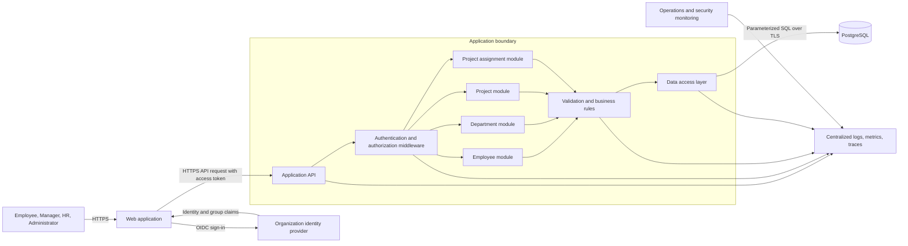
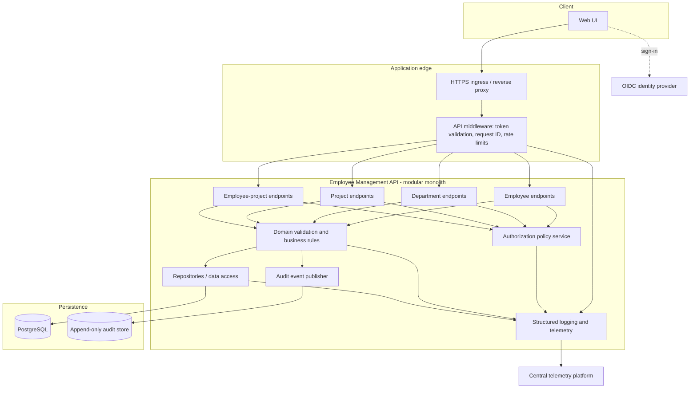
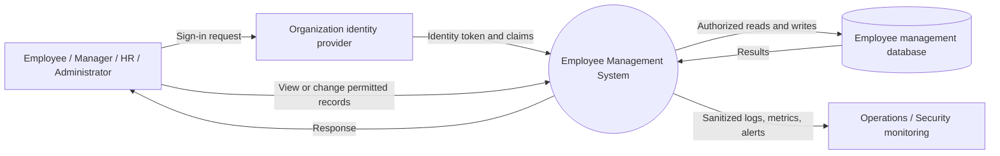
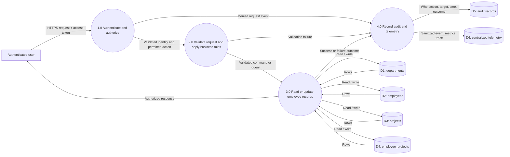

# Employee Management System Architecture

## 1. Scope and assumptions

This is a logical architecture for an employee management application backed
by the database in this repository. The repository currently contains database
scripts and sample data, not an application implementation.

- Use a **web client**, a **stateless application API**, and a **relational
  database**.
- Start with a modular monolith. Keep employee, department, project, and
  assignment capabilities as separate application modules; split services
  only when operational or scaling needs justify it.
- Use PostgreSQL as the production database. SQLite is suitable for local
  development, demonstrations, and tests, but not as a shared multi-user
  production database.
- Delegate authentication to an organizational identity provider using
  OpenID Connect (OIDC). The current schema does not contain user accounts,
  roles, or audit records; these are application/platform responsibilities or
  future schema additions.
- Treat salary and employee contact details as sensitive personal data.

## 2. Architecture diagram



The application API is the only runtime component that can access the
production database. Browser clients never connect to the database directly.
Identity is established by the identity provider; the API validates tokens
and applies application-level permissions on every request.

## 3. Component diagram



### Component responsibilities

| Component | Responsibility |
|---|---|
| Web UI | Presents role-appropriate screens; handles sign-in redirects; does not contain authorization as the sole control. |
| HTTPS ingress | Terminates or forwards TLS, applies request-size limits, and routes requests to the API. |
| API middleware | Validates access tokens, assigns a correlation ID, applies coarse rate limits, and normalizes request handling. |
| Domain modules | Implement employee, department, project, and assignment use cases and enforce business rules. |
| Policy service | Evaluates role and record-level access for every operation. |
| Repositories | Perform parameterized SQL and transaction management; do not make access-control decisions. |
| Audit publisher/store | Records security-relevant changes separately from diagnostic logs. |
| Telemetry | Collects structured logs, metrics, and traces with sensitive-data controls. |

## 4. Data flow diagram

### Level 0: system context



### Level 1: request and data stores



The API must filter sensitive records before returning them. Audit records are
not the same as diagnostic logs: audit events should be access-controlled,
retained according to policy, and protected against modification.

## 5. Security strategy

### Identity and access control

- Require organization-managed OIDC sign-in and short-lived access tokens.
  Validate token issuer, audience, signature, expiry, and required claims.
- Define server-side roles such as `employee`, `manager`, `hr`, and
  `administrator`. Map identity-provider groups to application roles.
- Enforce least privilege and record-level authorization in the API:
  employees see their own permitted data, managers see only their reporting
  scope, and HR access is limited to approved HR workflows. Administrative
  access is separate and audited.
- Deny access by default. Check permissions on every read, update, export, and
  assignment operation; never rely only on hidden UI controls.
- Do not use employee IDs supplied by a caller as proof of authorization.

### Data and application protection

- Use TLS for browser/API, API/identity-provider, and API/database connections.
- Use parameterized queries, input validation, output encoding, and
  context-appropriate CSRF protections for cookie-based sessions.
- Store credentials and signing secrets in a managed secret store; rotate them.
  Do not commit credentials or production personal data to source control.
- Encrypt database volumes and backups at rest; restrict database network
  access to the application runtime and approved administrative paths.
- Use separate least-privilege database identities for application runtime,
  migrations, and read-only reporting. Runtime credentials must not create
  schemas or administer the database.
- Minimize personal data in responses and logs. Apply explicit access controls
  to salary and other highly sensitive fields.
- Validate file exports (if added), limit their scope, audit them, and protect
  them from public or unintended sharing.
- Apply dependency updates, secure code review, vulnerability scanning, and
  periodic access reviews.
- Back up production data, encrypt backups, restrict restore permissions, and
  test restoration regularly.

### Database-specific controls

- Enforce foreign keys, uniqueness, and check constraints in the database as
  well as validating at the application boundary.
- Use transactions for multi-table changes, including employee-project
  assignments and related audit records where supported.
- Add database row-level security only if the selected database and
  authorization model can enforce it reliably; it complements rather than
  replaces API authorization.
- The current schema has no audit table, user/role table, soft-delete policy,
  or temporal history. Decide retention, deletion, and employment-history
  requirements before production use.

## 6. Logging and observability strategy

- Emit structured JSON logs with timestamp, severity, environment, service,
  operation, correlation ID, trace ID, outcome, and duration.
- Propagate a server-generated correlation ID across the request and its
  database operations. Do not trust an arbitrary client-supplied ID without
  validation.
- Record operational events (request failures, dependency failures, latency)
  separately from business audit events (who changed what and when).
- Never log passwords, tokens, session cookies, full request bodies, salary,
  or unnecessary personal data. Mask or omit sensitive identifiers.
- Centralize logs, metrics, and traces; restrict access and configure
  retention, redaction, and tamper protection according to organizational
  policy.
- Measure request rate, error rate, latency percentiles, database connection
  pool saturation, query latency, and authentication/authorization denials.
- Alert on sustained error-rate or latency thresholds, database unavailability,
  unusual authorization failures, and backup/restore failures. Avoid alerts
  containing sensitive payloads.

## 7. Exception handling strategy

- Validate at the API boundary and return actionable field-level validation
  errors without exposing implementation details.
- Use a consistent error response shape, for example:

  ```json
  {
    "code": "VALIDATION_FAILED",
    "message": "One or more fields are invalid.",
    "correlationId": "server-generated-id",
    "details": [
      { "field": "allocation_pct", "reason": "Must be greater than 0 and at most 100." }
    ]
  }
  ```

- Map expected failures to stable API outcomes: invalid input (`400`),
  unauthenticated (`401`), unauthorized (`403`), missing resource (`404`),
  duplicate/conflicting change (`409`), and unexpected server failure (`500`).
- Never return SQL text, stack traces, secrets, or internal infrastructure
  details to clients. Include the correlation ID so support can find the
  corresponding sanitized server-side event.
- Roll back the complete transaction on a failed multi-step write. Do not
  report success if persistence or audit requirements failed.
- Retry only transient dependency failures, with bounded exponential backoff
  and jitter. Retry writes only when they are idempotent or protected by an
  idempotency key.
- Translate known database constraint violations into safe domain errors;
  log unexpected database failures with context that excludes sensitive data.
- Keep cancellation and timeout behavior explicit. Set request and database
  timeouts and release connections in all success and failure paths.

## 8. Testing strategy

| Test level | What to verify |
|---|---|
| Unit | Domain rules: department membership, project status/date rules, salary constraints, assignment allocation, and authorization policy decisions. |
| Schema / migration | Both PostgreSQL and SQLite scripts apply cleanly to empty databases; primary keys, foreign keys, uniqueness, and check constraints reject invalid data. |
| Repository integration | Parameterized queries, transaction rollback, joins, pagination, and constraint-to-domain error mapping using the actual target database engine. |
| API integration | Authentication, role/record-level authorization, validation responses, error mapping, and permitted CRUD workflows. |
| End-to-end | Main user journeys: employee lookup, HR employee maintenance, manager project assignment, project roster review, and access denial for out-of-scope records. |
| Security | Dependency scanning, static analysis, authorization tests, injection tests, session/token handling, rate-limit behavior, and sensitive-data leakage checks. |
| Performance | Representative list/search/report queries, pagination, concurrent reads/writes, connection pool behavior, and agreed latency/load targets. |
| Resilience / operations | Database outage and recovery, timeout behavior, backup restore, alert delivery, log redaction, and correlation-ID propagation. |

Use synthetic test data. Keep tests deterministic and isolated; reset or
transactionally roll back integration-test data. Run fast unit and static
checks on every change, integration tests in CI, and security/performance
checks on an agreed schedule or before production releases. Test against
PostgreSQL for production compatibility; SQLite tests alone do not prove
PostgreSQL behavior.

## 9. Production readiness decisions

Before implementation or production launch, agree on:

- Hosting platform, supported environments, and availability objectives.
- Role definitions, manager reporting-scope rules, and salary visibility.
- Data classification, retention/deletion rules, privacy requirements, and
  audit retention.
- Database backup frequency, recovery-point objective, and recovery-time
  objective.
- API versioning, pagination limits, search behavior, and expected data volume.
- Migration ownership, deployment/rollback procedure, monitoring thresholds,
  and on-call responsibility.
